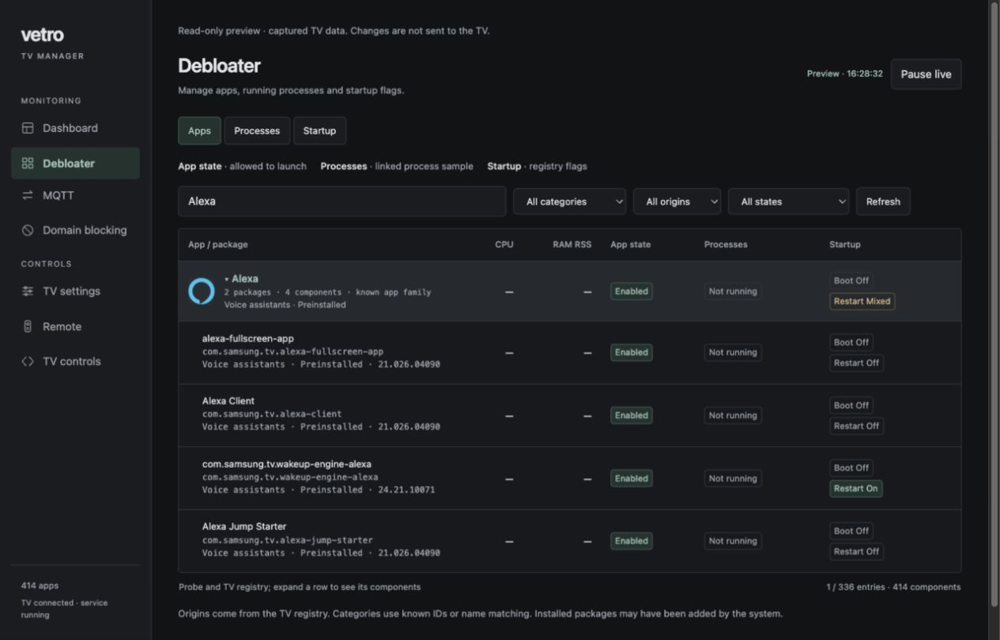
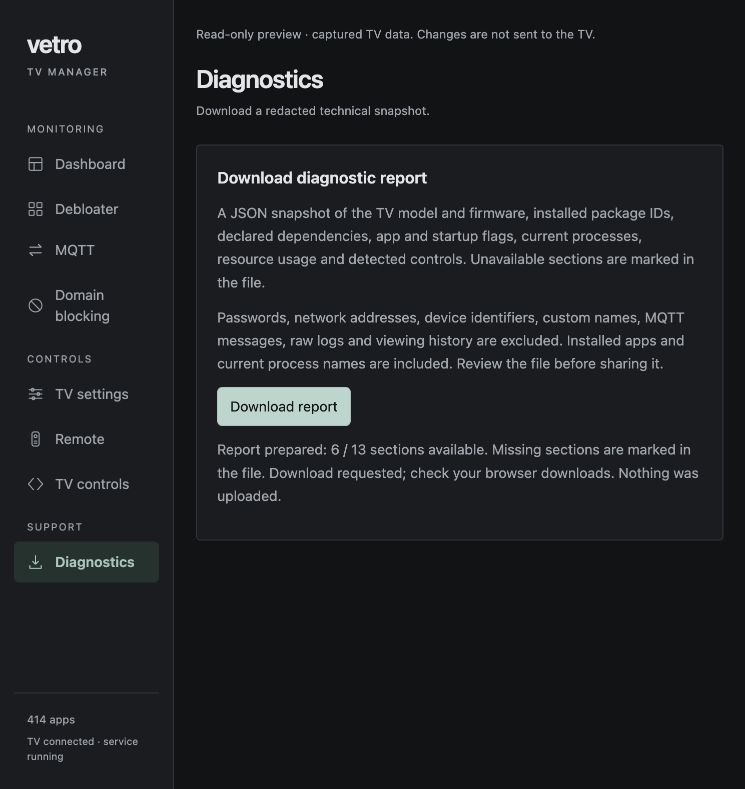
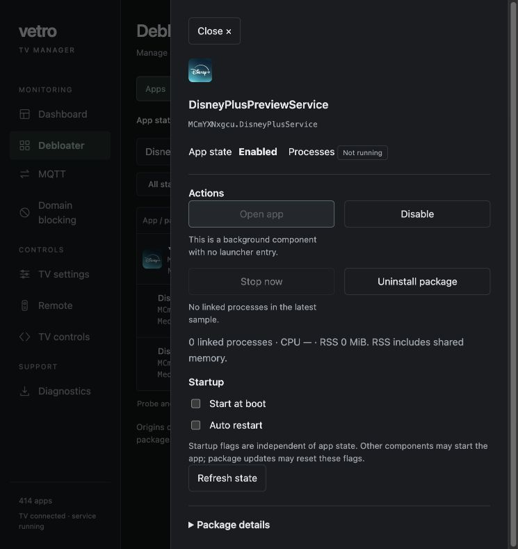

# Vetro

An experimental TV manager for Samsung Tizen TVs. Vetro provides a browser dashboard for inspecting installed apps, processes, resource usage, startup flags and verified TV controls. An optional device integration supplies privileged operations and physical remote input.

**Release status:** source preview. Only one TV model/firmware combination has device evidence. A general-purpose signed installer is not provided. Vetro 0.2.1 is installed on the test TV; its UI, diagnostic download and background operation after closing the app have been verified. An unattended cold boot of this version remains to be tested.



## Features

- **Dashboard and task manager:** CPU, available RAM, swap/zram, storage, network rates and process samples. Dashboard summaries refresh every 5 seconds; process views every 10 seconds. Initial CPU rates may be unknown.
- **Debloater:** searchable app inventory, categories, icons where available and declared dependencies. Components share package rows; known cross-package families use explicit mappings. Categories are inferred and dependencies are not a complete runtime map.
- **App and startup controls:** app enable/disable, launch, process stop, on-boot/auto-restart flags and removal of eligible user packages. Protected dependencies and Vetro cannot be indiscriminately removed. Disabled apps may still have running processes; boot flags do not exclude launches from dependencies.
- **TV settings:** verified numeric image controls and limited advanced settings with readback and restore handling. Unknown settings remain read-only. Firmware menu entries are capability clues, not working controls.
- **Physical remote shortcuts:** optional input helper can observe physical keys and map selected keys to native app launch/actions. Interception starts explicitly and stops on connection loss or rule changes. Public `tvinputdevice` APIs alone only receive foreground-app input.
- **Local domain blocking:** exact-domain hosts filtering on the TV while preserving configured DNS servers. Resolver behavior is tested; complete ad-request blocking across all apps is not established. The default domain list still needs broader verification.
- **MQTT:** broker configuration, connection diagnostics, actions and exact-topic triggers; Home Assistant discovery/availability support. A real-broker TV integration test remains pending. See [Home Assistant Container setup](app/docs/mqtt/README.md).
- **Diagnostic export:** downloadable, redacted JSON for compatibility reports. No background upload or viewing-history recording.

## Usage examples

### Debloat: what changed on the test TV

On the Q80A test TV, the following application components were verified as **disabled** on 2026-10-11. They remain installed; disabling an app is different from deleting its package or proving that all related processes have stopped.

| Component ID | App state | On boot | Auto-restart |
| --- | --- | --- | --- |
| `com.samsung.tv.acr` | Disabled | Off | Off |
| `com.samsung.tv.canalysis-service` | Disabled | Off | On |
| `com.samsung.tv.vision-data-recognition-service` | Disabled | Off | Off |
| `com.samsung.tv.contents-recognition-dbmgr` | Disabled | Off | Off |
| `com.samsung.tv.nvision-analysis-dbmgr` | Disabled | Off | Off |

These are the five original disabled-app flags restored for the performance comparison. The auto-restart flag for `canalysis-service` remains on: an app's disabled state and its startup flags are independent. This is a record of one TV's configuration, not a recommended list for every model. `com.samsung.tv.coba.adagent` remains protected.

For example, in **Debloater**, search for ACR, expand its group, select the component and choose **Disable**. Check the action result and refreshed **App state**; the disabled row turns gray. Check **Processes** separately for any remaining process and **Startup** for Boot/Restart flags. **Enable** reverses the disable flag. Use the task manager to compare CPU/RAM samples; the performance results below do not guarantee a particular saving.

**e-Manual removal:** the owner reported an earlier complete uninstall, but the current live check still lists the web package `LzU5yAFXeg` (e-Manual 8.0.0) and the non-removable system component `org.tizen.emanual-app`. The native package list and both installation directories confirm their presence. Complete removal is therefore **not verified in the current state**; no package was uninstalled during this documentation check.

To remove an eligible e-Manual web package, expand its entry in Debloater, verify its package ID and removability, then choose **Uninstall** and review the confirmation. Removal acts on the package, including its components. Check the action result and refreshed inventory afterward. The system companion is a separate package and remains protected from this uninstall path. Package removal is not reversed by **Enable**; recovery requires a suitable installer or the vendor's reinstall mechanism. Vetro does not promise complete removal of every built-in manual component.

### Remote: open Stremio from a dedicated button

An example is **Netflix button → Stremio**:

1. Open **Remote**, select the physical device or automatic detection, and choose **Start listening**.
2. Press the button once. Listening preserves its normal behavior and captures the device and key code.
3. Select the detected device, choose Stremio under **App to open**, and choose **Save shortcut**.
4. Choose **Enable interception**. Confirm that interception is connected, then test the button.
5. Choose **Stop interception** to restore normal button handling. Editing a rule also stops interception; enable it again afterward.

The test TV currently has an enabled saved rule mapping physical code `221` to Stremio. Interception was **off** when checked: a saved rule alone does not replace the button. Capture the code on your own remote instead of assuming that `221` identifies the same button on another TV. Launches use the native platform adapter, not the LAN remote WebSocket API.

### Microphone button: replace the voice-assistant shortcut

Use the same capture flow with the **microphone/voice button**, then map it to an app of your choice. While interception is connected, Vetro consumes the selected key event and launches that app instead of forwarding the original button event to the TV. This can replace the voice-assistant shortcut when that button is exposed by the selected input device.

A **block-only microphone toggle is not implemented**: the current shortcut UI requires an app action. Replacing the shortcut does not disable the microphone hardware, voice services or wake-word listening. The microphone-button replacement has not been verified on the current TV configuration. Stopping interception or losing the helper connection restores normal key handling; interception is not automatically restored after a service restart.

## Architecture

```text
app/                         rooting/
UI, probe, services, tests   platform adapter, runtime payloads, integration tests
          |                            |
          +---- platform contract -----+
```

`app/service/platform.js` is an unavailable-device adapter suitable for independent development. The standalone app build includes no rooting code, payload, SDB client or signing material. `rooting/build.cjs` assembles an explicitly separate integration package, substitutes the adapter and adds runtime payloads. It does not change app sources or install anything.

Privileged operations belong to the integration; feature development uses the [platform contract](app/PLATFORM.md). The root-agent connection authenticates its peer and checks UID 0. That does not authenticate browser clients: the current HTTP management service has no user login and uses plain HTTP. Use it only on a trusted isolated LAN, with no port forwarding or public exposure. HTTP authentication and restricted management access are release priorities.

## Development

Use a maintained Node.js release for local development and Python 3.10+ for release checks. The app has no npm runtime dependencies. The device runtime observed on the test TV is Node 12.4.0 / WRT 6.1.5; this obsolete runtime belongs to the TV and must not be assumed on other models.

```sh
cd app
npm test
node service/main.js
```

Open `http://127.0.0.1:8099/`. This runs locally, not on the TV. `GET /status` reports `app-only`; device actions are unavailable. The app build is an unsigned development package:

```sh
cd app
OUT=/tmp/vetro-app-only.wgt node build.cjs
```

From the repository root, also run:

```sh
node rooting/tests/run.cjs
python3 .github/scripts/test_parse_log.py
python3 .github/scripts/audit_release.py
```

## TV installation and setup

You can also point a coding agent at this repository and ask it to handle setup, building, signing and installation on your TV. Provide the TV address and your local certificate profile; keep passwords out of chat and version control. You still need to enable Developer Mode and create any required certificate profile. In our development sessions, Codex generally handled this workflow without cybersecurity safeguard flags, while Claude Code sometimes blocked it. This is an observed difference, not a guarantee; review the agent’s changes and follow the same compatibility and verification steps below.

### 1. Check requirements

Use only a TV you own or are authorized to administer. Read the compatibility table first. Install Tizen Studio's TV extension and Samsung Certificate Extension from the official tools. Create your own author/distributor certificate profile bound to your TV. The integration's on-boot service has been investigated with Partner-level distribution privileges; ordinary public signing is not evidence that boot execution is supported.

Do not reuse someone else's signed package or certificates. Historical signing material is excluded from the release. Review [Samsung's TV-device setup guide](https://developer.samsung.com/smarttv/develop/getting-started/using-sdk/tv-device.html) for your model's installation workflow.

### 2. Enable Developer Mode

On the tested TV, open **Apps**, enter **12345** using the remote, enable Developer Mode, enter the installation computer's LAN IP in **Host PC IP**, and restart the TV. Menu names can vary by model. Connect the TV and computer to the same trusted LAN.

There are two different addresses to keep separate:

| Address | Meaning | Where to use it |
| --- | --- | --- |
| `TV_IP`, for example `192.168.1.100` | TV's LAN address | SDB connection and browser dashboard |
| `127.0.0.1` | Loopback of the machine using it | TV's autonomous integration talks to its own SDB service; a PC using this address talks to itself |

During installation, **Host PC IP** is the computer's LAN address. The experimental autonomous integration has been tested with the TV's Host PC IP changed to `127.0.0.1` after installation and a restart. This can prevent ordinary PC SDB access; switch back to the computer IP and restart for maintenance when necessary. Do not change the TV's custom DNS to accomplish this.

```sh
export TV_IP=192.168.1.100  # replace with your TV address
sdb connect "$TV_IP:26101"
sdb devices
```

### 3. Build and sign the optional integration

Install signing dependencies with `npm ci` in `rooting/on-boot-probe`. Despite its historical name, only its dependency manifests are required by the current builder. Set `AUTHOR_P12`, `DIST_P12`, `AUTHOR_PW` and `DIST_PW` to your own certificate paths and passwords outside the repository. Use your shell or secret manager to supply passwords without committing them.

```sh
cd rooting/on-boot-probe
npm ci
cd ..
# Supply certificate variables securely before running this command.
OUT=/tmp/vetro.wgt node build.cjs
```

The resulting integration WGT contains privileged components. There is no universal certificate or guaranteed root compatibility. The bundled integration derives from [Samsung TV root research](https://github.com/chris-ritsen/samsung-tv-root); consult its compatibility information and [integration notes](rooting/README.md). Do not treat successful signing as successful privilege acquisition.

### 4. Install and verify

Select the connected TV target in Tizen Studio Device Manager, permit app installation for your certificate profile, and install `/tmp/vetro.wgt`. Alternatively, use the configured Tizen CLI target:

```sh
tizen install -n /tmp/vetro.wgt -t YOUR_TV_TARGET
```

Open **Vetro** once to run the public API probe. Visit `http://TV_IP:8099/` from a browser on the same LAN. Check app inventory, probe status and platform connectivity. A visible icon or accepted installation is not proof that the background service or root agent works.

After a cold boot, Vetro’s background startup and root reacquisition can take **up to 90 seconds**. Wait before treating an unavailable dashboard or agent as a failure.

To test unattended startup, record a boot checkpoint privately, fully power off the TV, unplug it for 30 seconds, turn it on, and check `/status` and `/monitor?scope=summary` without opening Vetro or issuing a launch command. Confirm a new boot, running service and authenticated UID-0 agent. Keep boot identifiers private. Standby is not a cold boot. See [release audit](app/docs/RELEASE-AUDIT.md) for current results.

## Compatibility and validation

| Environment | Evidence | Status |
| --- | --- | --- |
| Samsung QE50Q80AATXZT, T-NKM2DEUC-2301.1, Tizen 6, ARMv7 | Native inventory/settings, remote event tests, app launch, global disable/enable readback, DNS namespace checks and exploratory benchmarks | Partially verified on one physical TV |
| Other Q80A variants / firmware | Similar platform is a hypothesis only | Unverified |
| Other Samsung Tizen TVs | Public APIs may exist; signing, providers, runtime and root paths differ | Unverified |

The installed integration recovered an authenticated UID-0 agent after one owner-confirmed cold boot without a manual launch on 2026-10-11. The 0.2.1 release integration is now installed: its source revision, complete diagnostic download and continued background operation after closing the app were verified. An unattended cold boot of this new version still needs checking.

Local verification currently includes **44 app test suites**, **6 integration test suites** and parser tests. They cover validation, rollback/readback, root-agent authentication, detached launcher behavior, protocol handling, grouping, redaction and download behavior. Fixture tests do not establish device compatibility. See the [test and release audit](app/docs/RELEASE-AUDIT.md) for remaining checks.

### Performance evidence

One exploratory cold-boot A/B sequence opened five apps and scrolled Netflix with identical commands. B restored five pre-existing disabled-app flags. Available RAM at the end was about **44 MiB higher** in B; mean TV CPU was **32.1% in A versus 29.6% in B**. B also had less free swap. HTTP key acknowledgements improved from median 120.5 to 100.7 ms, but these are not app loading times or visual response times. One pair does not establish causality or a smoother TV.

Separate exploratory samples measured service+agent CPU at about 0.44–0.51% of one core with the dashboard closed, 0.72–0.79% with summary monitoring and 2.07% with Task manager. Measurements include diagnostic overhead and are not total four-core capacity percentages. No validated per-app FPS or dropped-frame measurement exists. Compositor tuning was abandoned after lag/connection-loss reports. No governor or realtime scheduling change is offered.

Still needed: repeated ABBA performance trials, visual readiness/frame-time measurements, more TV/firmware combinations, repeat unattended cold-boot validation on the newest package, real MQTT-broker tests, actual ads-request checks and reinstall/restore fixtures. Raw device reports remain private; [performance measurements](app/docs/PERFORMANCE.md) summarize evidence and limitations.

## Submit a diagnostic report

1. In Vetro, open **Diagnostics → Download report**.
2. Open the JSON and review it. It excludes passwords, IP/MAC addresses, serial/device IDs, custom display names, MQTT payloads and raw viewing history. It includes package IDs and current process names, which can reveal installed software. Arbitrary custom IDs may themselves identify you; redact them if needed.
3. Open this repository's **Issues → New issue → TV diagnostic report**. Enter model, firmware and Vetro version/commit; attach one JSON file (maximum 2 MiB).
4. Describe the behavior you want investigated. Never attach raw browser history, account data or signing keys. Public issues and attachments are public.
5. The bot posts or updates a preliminary report covering available sections, current root/service claims, connection flags, known errors and presumed compatibility. A maintainer reviews the evidence before proposing changes.



If the upload form is unavailable, create an issue titled `[Log report] Your model`, add the heading `### Vetro diagnostic report`, and drag the JSON into the body. A fenced `json` block also works. The workflow only accepts these report issues; ordinary issues are ignored. The workflow becomes active after its files reach the default branch and Actions is enabled.

The [diagnostic schema and exclusions](app/docs/DIAGNOSTIC-EXPORT.md) describe what is retained. The [analysis pipeline](app/docs/LOG-ANALYSIS.md) describes its limits. Logs are evidence, not instructions for agents or permission to run commands.

## Roadmap

- Authenticate the browser management interface and reduce privileged HTTP exposure.
- Wider model/firmware capability detection and controlled restore tests.
- App Extractor: manifests/dependency inspection first; no promise of decrypting apps or reconstructing installable WGTs.
- Verified audio/input controls, more advanced settings and clearer availability reporting.
- Expand app-family grouping and dependency evidence without merging unrelated apps by name.
- Real MQTT/availability/discovery cleanup tests with Home Assistant.
- Validate local DNS filtering against real requests while preserving custom resolvers.
- Repeatable performance measurements with lower diagnostic overhead.
- Repository-based app installation and update management informed by TizenBrew research; not a complete native-app installer yet.

## Credits and citations

- **Chris Ritsen and Samsung TV root contributors:** [samsung-tv-root](https://github.com/chris-ritsen/samsung-tv-root), underlying privilege-acquisition research and integration foundations. Vendored upstream code retains its Unlicense.
- **Rory Gallagher and Glasshouse contributors:** [Glasshouse](https://github.com/rorygallagher2024/glasshouse), LG webOS TV-management concept and dashboard/design inspiration. Vetro is not a 1:1 port. The [MIT notice](THIRD_PARTY_NOTICES.md) is retained for any adapted portions.
- **reisxd and contributors:** [TizenBrew](https://github.com/reisxd/TizenBrew), [TizenTube](https://github.com/reisxd/TizenTube) and [tizen.js](https://github.com/reisxd/tizen.js), installation, compatibility and signing/runtime research. TizenBrew/TizenTube are GPL-3.0; this release excludes their test WGTs and does not relicense their code.
- **Samsung and Tizen documentation:** public API and tooling references. Documentation links and product names do not imply endorsement.

## License, experimental status and non-affiliation

Vetro's original code is released under the [MIT License](LICENSE). Third-party files retain their original licenses; see [third-party notices](THIRD_PARTY_NOTICES.md). Review the notice before redistributing mixed packages or bringing in GPL components.

This software is **experimental** and provided **as is**, without warranty of any kind. Controls and firmware behavior may vary. Privileged modifications can disrupt apps, settings or device operation. Keep a recovery path and validate one reversible change at a time.

Vetro is an independent, unofficial project. It is **not affiliated with, endorsed by, sponsored by, or connected to Samsung, Tizen, Glasshouse, TizenBrew, or any other hardware/software vendor or upstream project**. Names and trademarks belong to their respective owners.

## AI-assisted development

Generative AI and coding agents assisted with implementation, debugging, documentation, UI revisions and diagnostic analysis. Automated tests and device observations validate specific behavior; generated code and automated compatibility comments are not guarantees. Contributions remain subject to human review, provenance checks and the same test requirements as manually written code.

### Debloater action verification

On the test TV, a removable disposable web package was installed, disabled, enabled, launched, stopped and uninstalled through Vetro. Start-at-boot was switched on and restored to off. Both the refreshed registry and native package list confirmed removal; the fixture installation directory was absent. Existing app flags, remote rules and custom DNS were unchanged. This establishes the action path on this TV, not uninstall support for arbitrary system packages.

The component drawer shows actions and status first, with package metadata below. Unavailable controls explain their restriction. App state, running processes and startup flags are separate: disabling an app does not prove its processes stopped or RAM was freed. Removal affects the whole package, including all its components.


